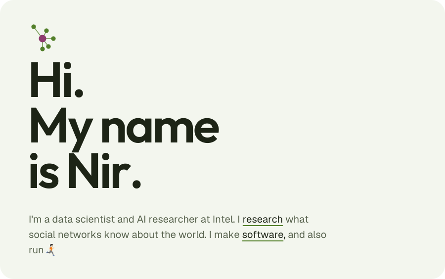
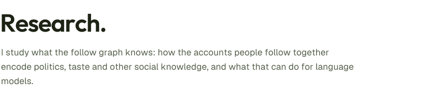
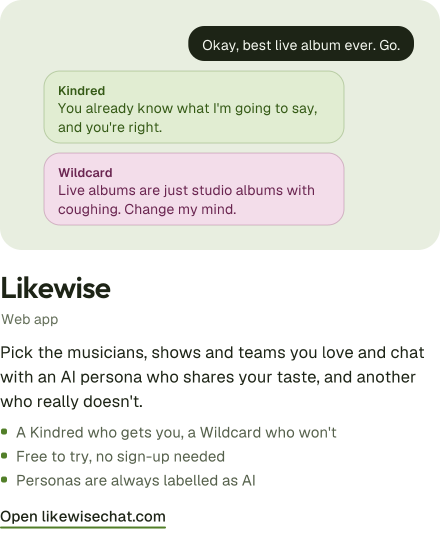
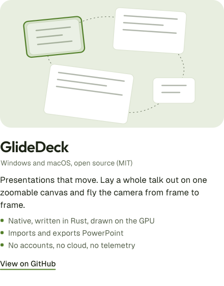
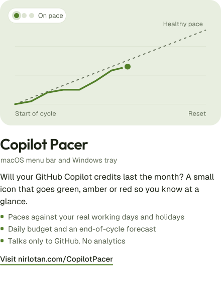
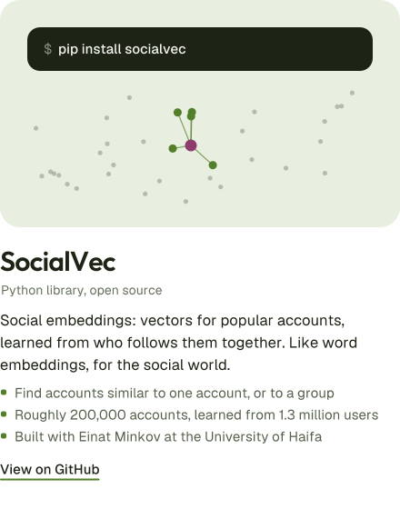
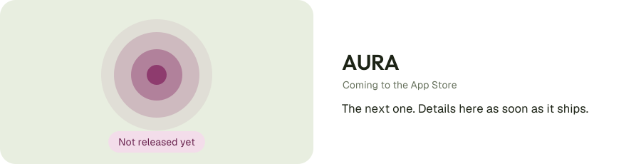

<a href="https://nirlotan.com"><picture><source media="(prefers-color-scheme: dark)" srcset="assets/header-dark.svg"></picture></a>

<a href="https://nirlotan.com">nirlotan.com</a> &nbsp;·&nbsp; <a href="https://scholar.google.com/citations?user=0L8U4h8AAAAJ">Google Scholar</a> &nbsp;·&nbsp; <a href="https://github.com/nirlotan?tab=repositories">All repositories</a>

 

<a href="https://scholar.google.com/citations?user=0L8U4h8AAAAJ"><picture><source media="(prefers-color-scheme: dark)" srcset="assets/research-dark.svg"></picture></a>

<a href="https://journals.sagepub.com/doi/10.1177/08944393261506316"><picture><source media="(prefers-color-scheme: dark)" srcset="assets/paper-1-dark.svg"></picture></a> 
<a href="https://arxiv.org/abs/2603.10148"><picture><source media="(prefers-color-scheme: dark)" srcset="assets/paper-2-dark.svg"></picture></a> 
<a href="https://scholar.google.com/citations?user=0L8U4h8AAAAJ"><picture><source media="(prefers-color-scheme: dark)" srcset="assets/paper-3-dark.svg"></picture></a> 
<a href="https://doi.org/10.1371/journal.pone.0283700"><picture><source media="(prefers-color-scheme: dark)" srcset="assets/paper-4-dark.svg"></picture></a> 
<a href="https://arxiv.org/abs/2111.03514"><picture><source media="(prefers-color-scheme: dark)" srcset="assets/paper-5-dark.svg"></picture></a> 

 

<picture><source media="(prefers-color-scheme: dark)" srcset="assets/projects-dark.svg"></picture>

<a href="https://likewisechat.com/"><picture><source media="(prefers-color-scheme: dark)" srcset="assets/likewise-dark.svg"></picture></a>&nbsp;&nbsp;<a href="https://github.com/nirlotan/GlideDeck"><picture><source media="(prefers-color-scheme: dark)" srcset="assets/glidedeck-dark.svg"></picture></a>

<a href="https://github.com/nirlotan/copilot-pacer"><picture><source media="(prefers-color-scheme: dark)" srcset="assets/copilot-pacer-dark.svg"></picture></a>&nbsp;&nbsp;<a href="https://github.com/nirlotan/SocialVec"><picture><source media="(prefers-color-scheme: dark)" srcset="assets/socialvec-dark.svg"></picture></a>

<picture><source media="(prefers-color-scheme: dark)" srcset="assets/aura-dark.svg"></picture>

 

<a href="https://nirlotan.com"><picture><source media="(prefers-color-scheme: dark)" srcset="assets/footer-dark.svg"></picture></a>
